# GitHub Profile Trophy: League of Legends Edition

GitHub achievements displayed with embedded League of Legends rank emblems. The
generated image is self-contained and works in GitHub README files. Based on
[ryo-ma/github-profile-trophy](https://github.com/ryo-ma/github-profile-trophy).



## Your profile README

The daily workflow updates **`trophy.svg` at the repository root**. Keep using
that file URL in your profile README. For this repository:

```markdown

```

The filename stays stable. GitHub's image proxy may take time to refresh cached
images.

## Automatic updates

The Update trophies workflow runs daily and can be started manually from
Actions. It uses the repository owner's username and the built-in `GITHUB_TOKEN`
by default. An optional `TROPHY_TOKEN` secret can provide additional visibility
when needed. Only `trophy.svg` is committed, only when changed, without force
pushes. Failed generation leaves the previous image intact.

No Vercel deployment, second token, or background server is needed for scheduled
updates. GitHub API rate limits still apply during generation.

## Local development

Install Deno 2, set `GITHUB_TOKEN1` in your environment, then run:

```sh
deno task generate harshitt13
deno task test
deno task lint
deno fmt --check
```

Generation accepts `USERNAME [OUTPUT_PATH] [THEME] [API_URL]`. Defaults are
`trophy.svg` and `lol`. Supply an API URL only to fetch an existing deployment.
Nested output directories require broader write permissions than
`deno task generate`.

## Optional HTTP endpoint

Set `PROFILE_USERNAME` and `GITHUB_TOKEN1`, then run `deno task start`. The
endpoint only serves the configured profile. Existing Vercel configuration and
composite Action inputs remain available.

| Parameter              | Behavior                                                        |
| ---------------------- | --------------------------------------------------------------- |
| `theme`                | Defaults to `lol`; legacy theme values use LoL icons            |
| `title`                | Comma-separated categories, such as `Stars,Commits,PullRequest` |
| `rank`                 | LoL ranks or original tiers; prefix with `-` to exclude         |
| `column`, `row`        | Grid limits, default 8 columns and 3 rows                       |
| `column=-1`            | Fit all trophies in one row                                     |
| `margin-w`, `margin-h` | Spacing in pixels, from 0 to 50                                 |
| `no-bg=true`           | Transparent backgrounds                                         |
| `no-frame=true`        | Hide card borders                                               |

Ranks: Iron, Bronze, Silver, Gold, Platinum, Diamond, Master, Grandmaster,
Challenger. Secret achievements also use Challenger emblems. Scores follow the
original trophy thresholds. Commit and review counts come from GitHub's
contributions collection, not lifetime totals. Stars and languages are based on
the repositories returned by the API query.

## Maintenance

CI checks formatting, lint, tests, and entry-point types on pushes and PRs.
Enable the Renovate GitHub app for this repository to activate
[the dependency update configuration](.github/renovate.json). It covers Deno
imports and GitHub Actions, groups minor and patch updates, and keeps major
updates separate for review. Automatic merging is disabled.

## License and attribution

See [LICENSE](LICENSE) for upstream attribution. League of Legends rank artwork
belongs to its respective owners. This project is not affiliated with Riot
Games.
